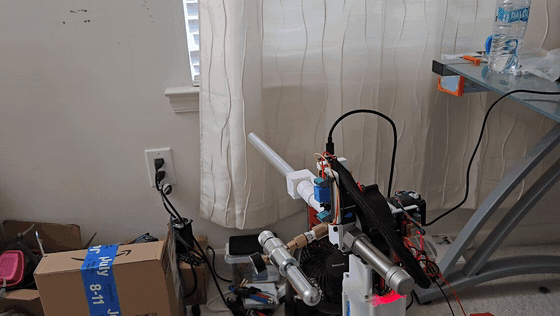

# Xiang Wang

Mechanical engineering senior at Penn State with a minor in mechatronics, graduating December 2026. My projects span mechanical design, power and motor control electronics, and embedded firmware. I am looking for full time hardware and robotics engineering roles starting January 2027.

**[Portfolio site](https://xiang-wang-us.github.io)** · [LinkedIn](https://linkedin.com/in/xiangwang102) · [Email](mailto:20o5xwang@gmail.com)

## Featured: Autonomous Tracking Turret

I designed and built the hardware for a turret that tracks a person and fires foam darts. Direct drive steppers could not move the top heavy head, so I designed printed cycloidal reducers for both axes. An ESP32 streams video to a laptop that runs pose detection and sends aim corrections back over UDP.

- **12:1 and 18:1** printed cycloidal reducers on NEMA 17 steppers
- **97%** of peak modeled dart speed from a 0.3 m barrel
- **2 weeks** hardware build for under $150

[Repository](https://github.com/xiang-wang-US/Cycloidal_Turret) · [Case study PDF](https://github.com/xiang-wang-US/Cycloidal_Turret/blob/main/docs/Turret_Case_Study.pdf) · [Web version](https://xiang-wang-us.github.io/projects/turret.html)

## Projects

| Project | My role | Result | Links |
|---|---|---|---|
| **Autonomous Tracking Turret** Summer 2025 | Mechanical design, electronics, firmware | Working tracking and firing prototype, under $150 | [Repo](https://github.com/xiang-wang-US/Cycloidal_Turret) · [PDF](https://github.com/xiang-wang-US/Cycloidal_Turret/blob/main/docs/Turret_Case_Study.pdf) |
| **Competition Hovercraft** 2024 to 2025 season, competition March 2025 | Lead engineer | First place, Best Hovercraft | [Repo](https://github.com/xiang-wang-US/Competitive_Hovercraft) · [PDF](https://github.com/xiang-wang-US/Competitive_Hovercraft/blob/main/docs/Hovercraft_Case_Study.pdf) |
| **6 lb Combat Robot** Fall 2025 to April 2026 | Electrical subsystem lead | 2nd of 16 teams | [Repo](https://github.com/xiang-wang-US/Combat_Robot) · [PDF](https://github.com/xiang-wang-US/Combat_Robot/blob/main/docs/Combat_Robot_Case_Study.pdf) |
| **Heavy Lift Drone** Fall 2025 to April 2026 | Electrical subsystem lead | Flew with a payload in cage testing | [Repo](https://github.com/xiang-wang-US/Heavy_Lift_Drone) · [PDF](https://github.com/xiang-wang-US/Heavy_Lift_Drone/blob/main/docs/Heavy_Lift_Drone_Case_Study.pdf) |
| **Spring Plunger Blaster** May to August 2024 | Sole designer | Mechanisms prototyped and tested; full blaster not assembled | [Repo](https://github.com/xiang-wang-US/Nerf_Blaster) · [PDF](https://github.com/xiang-wang-US/Nerf_Blaster/blob/main/docs/Nerf_Blaster_Case_Study.pdf) |

## Experience

**Microsoft** · Mechanical Engineering Intern, Surface Hardware · Summer 2026\
Designed and prototyped a user serviceable mounting architecture for a device input component. Modeled in Creo and built over multiple prototype cycles, consolidating 6 CNC machined parts into 2 formed sheet metal parts. Delivered a tradeoff analysis across mechanical, cost, industrial design, and RF impact.

**The Learning Factory, Penn State** · Machine Shop Instructor · 2024 to 2026\
Trained students on safe operation of 30+ machines, including mills, lathes, and welders, in a shop serving 500+ students and faculty weekly.

**Klipper Printer Rebuild** · Personal project · 2024\
Reflashed and tuned a 3D printer on Klipper firmware, cutting print time 70% with equal or better quality.

## Skills

- **CAD and analysis:** SolidWorks, Creo, Fusion 360, FEA, CFD, DFM and DFA, tolerance stackup
- **Electronics and controls:** ESP32, motor control, power distribution, PCB design, digital logic and FSM design, soldering
- **Programming:** Embedded C++, Python, MATLAB, VHDL
- **Fabrication:** Sheet metal, welding (MIG, TIG, stick), lathe, mill, 3D printing, laser engraving
